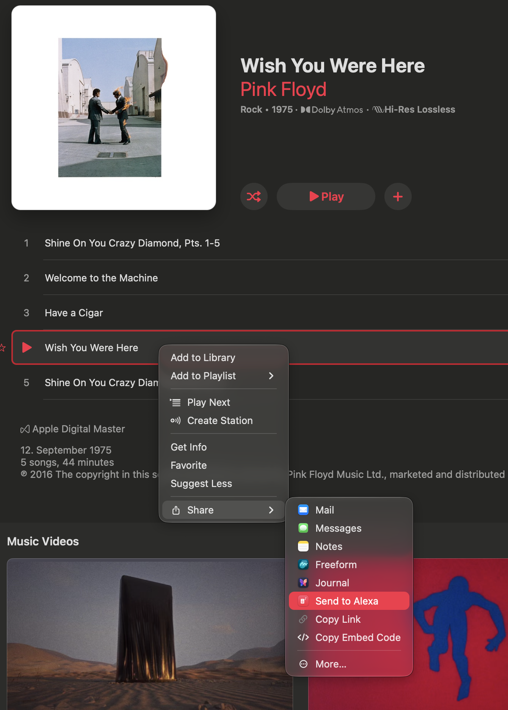
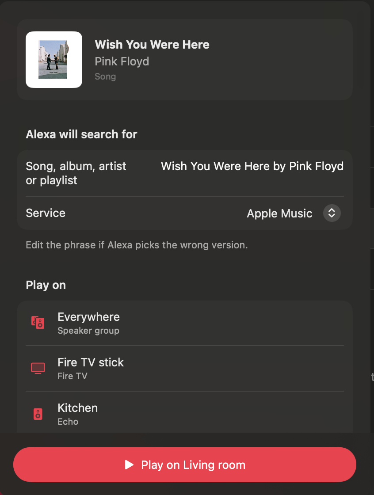
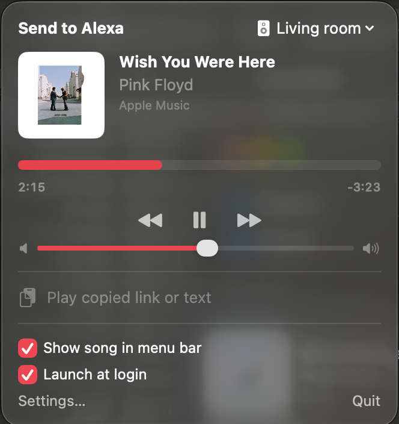

# Send to Alexa

[](https://github.com/filipegarcia/send-to-alexa/actions/workflows/ci.yml)

Share a song from **Apple Music** on your iPhone (or Mac) and it starts playing on the **Echo of your choice**.

```
Apple Music ─▶ Share ─▶ Send to Alexa ─▶ pick "Kitchen" ─▶ ▶︎ plays on the Kitchen Echo
```

| 1. Share from Music.app | 2. Pick the Echo | 3. Control it from the menu bar |
| :---: | :---: | :---: |
|  |  |  |

There is no official way to do this: Alexa skills can't be triggered from your phone, and they can't play
Apple Music. So this project skips skills entirely and does what the Alexa app itself does — it asks Alexa to run a
one-off routine with a *"play ‹song› by ‹artist› on Apple Music"* step on the device you picked.

> **Unofficial.** Not affiliated with Amazon or Apple. It uses the same private web API as the Alexa app and
> the long-running open-source projects ([alexa-remote-control], [alexa-cookie2], [alexa_media_player]).
> Amazon can change that API at any time.

## What's in the box

| Piece | What it does |
| --- | --- |
| **iOS app** (`iOS/App`) | Sign in with Amazon, choose your default Echo and music service, test a link. |
| **iOS share extension** (`iOS/ShareExtension`) | Appears in the Share sheet of Apple Music (and Safari, Messages, …). Shows the song, lets you pick the Echo, plays. |
| **AlexaKit** (`AlexaKit/`) | Swift package with all the logic: Amazon sign-in, device list, play/speak, Apple Music link → search phrase. No dependencies. |
| **`alexa-send` CLI** (`AlexaKit/Sources/alexa-send`) | Same features from the terminal. Great for trying things out and for scripts. |
| **macOS menu bar app + share extension** (`macOS/`) | Lives in the menu bar: what your Echo is playing (artwork, progress), play/pause/skip/volume, pick the Echo, play a copied link. Plus Music.app › Share › Send to Alexa. |

## Quick start (iPhone)

Requirements: a Mac with **Xcode 16+**, an iPhone on iOS 17+, a free or paid Apple ID, and Apple Music
linked in the Alexa app (*Alexa app › More › Settings › Music & Podcasts › Link New Service*).

```bash
git clone https://github.com/filipegarcia/send-to-alexa.git
cd send-to-alexa
make setup TEAM=<your Team ID> PREFIX=com.<yourname>   # writes Config/Local.xcconfig (git-ignored)
open SendToAlexa.xcodeproj
```

1. In Xcode pick the **SendToAlexa-iOS** scheme and your iPhone, then **Run**.
   - *Team ID*: Xcode › Settings › Accounts › your team. With a free Apple ID this is your "Personal Team".
   - First run on a device: iPhone › Settings › General › VPN & Device Management › trust your developer certificate.
2. In the app choose your country and tap **Sign in with Amazon**. You sign in on Amazon's own page (2FA works).
3. Pick your default Echo.
4. In Apple Music: **•••** › **Share** › **Send to Alexa**. If it's not in the row of apps, scroll to the end,
   tap **More** / **Edit Actions…** and enable it once.

The share sheet preselects your default Echo. Turn on *"Play immediately on the default Echo"* in the app if
you want sharing to start playback with no further taps.

## Quick start (Mac)

```bash
make setup PREFIX=com.<yourname> TEAM=<your Team ID>   # TEAM is optional on the Mac
make run-mac
```

`make run-mac` builds the app, installs it in `~/Applications`, enables its Share extension and opens it.
It's a **menu bar app** (no Dock icon): click the speaker icon to see what your Echo is playing, control it,
switch Echo, or play an Apple Music link you've copied. Optional: show the song title in the menu bar, launch at
login. "Settings…" opens the sign-in / preferences window.
No paid developer account is needed: with no Team it's signed to run locally, and with a free Apple ID
(Xcode › Settings › Apple Accounts) it's signed with your Personal Team.

1. Sign in from the app, or with the CLI (see below). **The Mac app, its Share extension and the CLI share one
   sign-in** in `~/.config/send-to-alexa`, so signing in once anywhere is enough.
2. In Music.app: right-click a song (or **•••**) › **Share** › **Send to Alexa**. If it isn't listed, choose
   **More…** at the bottom of the Share menu (or *System Settings › General › Login Items & Extensions › Sharing*)
   and enable it.

## Quick start (terminal)

```bash
cd AlexaKit
swift run alexa-send login --region amazon.de        # your Alexa country; opens Amazon sign-in in the browser
swift run alexa-send devices                         # * marks the default device
swift run alexa-send play --device Kitchen "https://music.apple.com/de/album/wish-you-were-here/1065973975?i=1065973980"
swift run alexa-send play "Pink Floyd Essentials playlist"   # any search works too
swift run alexa-send play --check --device Kitchen "Comfortably Numb by Pink Floyd"   # ask Alexa to validate only — silent
swift run alexa-send now-playing --device Kitchen    # what is the Echo playing?
swift run alexa-send control pause --device Kitchen  # play | pause | next | previous | volume 40
swift run alexa-send --help
```

After signing in in the browser you land on a page that looks broken ("Looking for something?") — that's
expected. Copy the full URL from the address bar (it contains `/ap/maplanding`) and paste it into the terminal.

Credentials are stored in `~/.config/send-to-alexa/` (mode `0600`). Set `SEND_TO_ALEXA_HOME` to use another folder.

## How it works

1. **Sign-in** — the app opens Amazon's sign-in page as if it were the Alexa iOS app (OpenID + PKCE). After
   you sign in, Amazon redirects with an authorization code, which is exchanged for a **refresh token** by
   registering a virtual device called "*‹Your name›'s Send to Alexa*" on your account.
2. **Session** — the refresh token is swapped for `alexa.amazon.‹tld›` cookies + a CSRF token when needed
   (cached for 12 h, renewed automatically).
3. **Link → phrase** — Apple Music links are turned into a natural phrase using Apple's public
   [iTunes Lookup API](https://performance-partners.apple.com/search-api) (songs, albums, artists) or the public
   page title (playlists, stations): *"Wish You Were Here by Pink Floyd"*, *"the album The Wall by Pink Floyd"*,
   *"the Pink Floyd Essentials playlist"*.
4. **Play** — `POST /api/behaviors/operation/validate` then `POST /api/behaviors/preview` with an
   `Alexa.Music.PlaySearchPhrase` node for the chosen device and `APPLE_MUSIC` provider — exactly what an
   Alexa routine's *Music* action does.
5. **Check** — the Echo reports what it's playing (`GET /api/np/player`). If it isn't the shared song
   (title must match exactly — a "(Live)" or "(Remix)" counts as different — and the artist or album must match),
   or if nothing started, it retries with other wording: *"the song Comfortably Numb by Pink Floyd"*, then
   *"Comfortably Numb by Pink Floyd from the album The Wall"*. For classical titles it searches the movement and
   performer, e.g. *"Cuckoo from Friday Afternoons by Choir of Downside School"*. If Alexa still misses, the
   share sheet stays open, shows what's playing, and lets you edit the search.

More detail, request by request: [docs/how-it-works.md](docs/how-it-works.md).

### Why not play the exact track ID?

Because Alexa doesn't allow it. Apple Music on Echo is a third-party *music skill*: Alexa turns your request into
a search ("song X by artist Y") and Apple's skill picks the match. There is no API — official or unofficial —
that hands a catalog ID to the Apple Music skill (the Echo's own queue doesn't even expose Apple's IDs).
So Send to Alexa does the next best thing: search as precisely as possible, check, and retry.

### Where your data lives

- **iOS app:** the Keychain, in an access group shared only by the app and its own share extension.
- **Mac app, Mac share extension and CLI:** `~/.config/send-to-alexa/*.json` (mode `0600`, readable only by you).
  The sandboxed Mac targets get a read/write exception for just that folder.
- Nothing is sent anywhere except Amazon (sign-in + Alexa) and Apple (link lookup). No analytics, no servers.
- **Sign out** removes the virtual device from your Amazon account and deletes local data. You can also remove
  it at *amazon.‹tld› › Manage Your Content and Devices › Devices*.

## Project layout

```
.
├── AlexaKit/                 Swift package (library + CLI + tests) — start here
│   ├── Sources/AlexaKit/
│   │   ├── AmazonLogin.swift     sign-in URL, PKCE, device registration, cookies, sign-out
│   │   ├── AlexaClient.swift     devices, play, speak (actor; auto-refreshes the session)
│   │   ├── MusicLink.swift       Apple Music URL parsing + resolution to a search phrase
│   │   ├── Storage.swift         Keychain / file / memory stores, Preferences
│   │   └── SendToAlexa.swift     high-level facade used by the apps
│   ├── Sources/alexa-send/       CLI
│   └── Tests/AlexaKitTests/      unit tests (no network; mocked transport)
├── Shared/
│   ├── Common/               used by apps *and* share extensions (ShareView, ShareModel)
│   └── App/                  used by the apps only (ContentView, sign-in web view)
├── iOS/App, iOS/ShareExtension
├── macOS/App (menu bar app), macOS/ShareExtension
├── Config/                   Base.xcconfig + your git-ignored Local.xcconfig
├── project.yml               XcodeGen spec → SendToAlexa.xcodeproj
└── scripts/make-icon.swift   renders the app icons + menu bar glyph
```

## Development

```bash
make help        # list tasks
make test        # AlexaKit unit tests
make build-ios   # compile iOS app + extension for the simulator (no signing needed)
make build-macos # compile macOS app + extension (no signing needed)
make build       # all of the above + tests (what CI runs)
make run-mac     # build + install + launch the Mac app with its Share extension
make project     # regenerate SendToAlexa.xcodeproj after editing project.yml (brew install xcodegen)
make cli         # release build of alexa-send
```

The Xcode project is generated with [XcodeGen](https://github.com/yonaskolb/XcodeGen) and committed, so you only
need XcodeGen if you add/remove files or targets.

### Using AlexaKit in your own code

```swift
import AlexaKit

let app = SendToAlexa(store: AlexaStore(KeychainStore()))
let devices = try await app.refreshDevices()
let music = try await app.resolver.resolve(url: URL(string: "https://music.apple.com/de/album/wish-you-were-here/1065973975?i=1065973980"), text: nil)
try await app.play(music.searchPhrase, on: devices[0], provider: .appleMusic)
```

## Troubleshooting

| Symptom | Fix |
| --- | --- |
| "Send to Alexa" missing from the share sheet | Run the app once first. iPhone: scroll the app row to the end › **More** › enable it. Mac: enable it in System Settings (see Quick start). |
| Share sheet says "Not signed in" | Open the app and sign in. App and extension must be signed with the same Team (they share a Keychain group). |
| Plays the wrong song/version | It retries automatically; if it still misses, edit the phrase in the share sheet (add the album name, "original", "live", the year…). `alexa-send now-playing` shows what the Echo picked. |
| "Provider not linked" / nothing plays | Link Apple Music in the Alexa app and check the music service picker in Send to Alexa. |
| "Your Amazon session expired" | Sign out and sign in again (the virtual device was removed or Amazon revoked the token). |
| Sign-in page keeps failing | Try another *Alexa country*, or with the CLI `--sign-in-domain amazon.<your tld>`. |
| Speaker groups don't play | Amazon's API doesn't always accept multi-room groups for this action; pick a single Echo. |

## Contributing

Issues and PRs welcome. Please keep AlexaKit dependency-free and covered by tests (`make test`), and never
commit credentials — `Config/Local.xcconfig` and anything in `~/.config/send-to-alexa` stay on your machine.

## Credits

The Amazon sign-in and Alexa API details come from the excellent work in
[alexa-remote-control], [alexa-cookie2] / [alexa-remote] by Apollon77, [alexa_media_player], and
[mkb79/Audible](https://github.com/mkb79/Audible).

## Icon

The icon, a white speech-bubble ring around a music note on red (reversed to a red mark on white at menu sizes), is original artwork drawn from vector shapes by
[`scripts/make-icon.swift`](scripts/make-icon.swift). Run `make icon` to regenerate the iOS and macOS icons and
the menu bar glyph. It isn't Amazon's or Apple's logo, and it doesn't use SF Symbols, whose license excludes
app icons.

## License

MIT — see [LICENSE](LICENSE).

[alexa-remote-control]: https://github.com/thorsten-gehrig/alexa-remote-control
[alexa-cookie2]: https://github.com/Apollon77/alexa-cookie
[alexa-remote]: https://github.com/Apollon77/alexa-remote
[alexa_media_player]: https://github.com/alandtse/alexa_media_player
